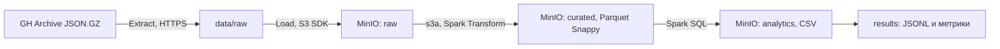

# ХАСД — практическая работа № 2

Пакетный ELT-пайплайн над реальными событиями GitHub: Java 17, Spark 3.5.8 и MinIO.
Цель — загрузить исходные данные в хранилище, затем подготовить аналитический слой и выполнить SQL-запросы. Полный режим требует не менее 550 MiB сжатых исходных файлов. Smoke-режим предназначен только для отладки и не заменяет полную проверку.

## Архитектура



До Load выполняются только скачивание и проверка целостности. JSON разбирается и преобразуется Spark после загрузки в MinIO. Spark читает исходные объекты именно через `s3a://raw/` и пишет `s3a://curated/`.

## Версии и совместимость

| Компонент | Версия |
|---|---|
| Java | Eclipse Temurin 17 |
| Gradle Wrapper | 8.14.4 |
| Spark / Scala | 3.5.8 / 2.12 |
| Hadoop client / hadoop-aws | 3.3.4 / 3.3.4 |
| AWS SDK bundle | 1.12.262 |
| MinIO | RELEASE.2025-04-22T22-12-26Z |
| JUnit | 5.11.4 |

[POM Spark 3.5.8](https://github.com/apache/spark/blob/v3.5.8/pom.xml) закрепляет Hadoop 3.3.4. [POM Hadoop 3.3.4](https://github.com/apache/hadoop/blob/rel/release-3.3.4/hadoop-project/pom.xml) закрепляет AWS SDK 1.12.262. Версия `hadoop-aws` совпадает с Hadoop в Spark; произвольное обновление только SDK или S3A может приводить к `NoSuchMethodError`. См. [официальное описание S3A](https://hadoop.apache.org/docs/r3.3.4/hadoop-aws/tools/hadoop-aws/index.html).

Spark и Hadoop не включаются в JAR приложения: их предоставляет фиксированный образ `apache/spark:3.5.8-scala2.12-java17-python3-ubuntu`. Сборка копирует только `hadoop-aws` и AWS SDK в `build/dependencies`, Dockerfile добавляет их в одинаковые образы Master и Worker. На запуске Maven-зависимости не скачиваются. Python из базового образа не используется.

Готовые образы MinIO выбранного выпуска оказались недоступны при проверке 09.10.2026: Docker Hub — `pull access denied`, Quay — `401`, официальный архив бинарников — HTTP 410. Поэтому `docker/Dockerfile.minio` собирает **официальный исходный код** выпуска из commit `0d7408fc9969caf07de6a8c3a84f9fbb10a6739e` с Go 1.24.2, указанным в его go.mod. Исходный код MinIO не изменяется. Это следует рекомендации [официального репозитория MinIO](https://github.com/minio/minio) собирать Community Edition из исходников. Первая сборка дольше обычной; дальнейшие сборки используют Docker cache. В runtime используется уже выбранный базовый образ Spark, его слои разделяются между контейнерами; JVM в MinIO не запускается. Лицензия и CREDITS находятся в `/licenses`. Bucket создаёт minio-init через Java S3 SDK; отдельный клиент `mc` не требуется.

## Источник данных

[GH Archive](https://www.gharchive.org/) публикует почасовые архивы публичных событий GitHub. Загрузка начинается с **2024-10-01 00:00 UTC**. Пример: `https://data.gharchive.org/2024-10-01-0.json.gz`.

Загрузчик последовательно скачивает целые часы до достижения 550 MiB (576 716 800 байт), максимум 168 часов по умолчанию. Поэтому итоговый объём обычно немного больше заданного. Формат — JSON Lines внутри GZIP. Записи не размножаются. В `manifest.tsv` записываются имя, URL, размер и SHA-256 каждого выбранного файла.

Успешные локальные архивы повторно проверяются полностью через GZIP (включая CRC), но не скачиваются. Незавершённый `.part` скачивается заново; ранее завершённые часы сохраняются. При сетевой ошибке предусмотрены четыре попытки с задержками. При исчерпании временного диапазона выдаётся ошибка. Манифест описывает точный набор текущего запуска: оставшиеся от прежних запусков объекты не попадают в Transform.

## Первый запуск на Windows 11

Нужны Docker Desktop с Linux containers и Eclipse Temurin JDK 17. Желательно выделить Docker не менее 10 GiB памяти, иметь несколько гигабайт свободного места и интернет. Контейнеры ограничены: MinIO 1 GiB, Master с драйвером 4 GiB, Worker 4 GiB, executor 2 GiB и два ядра.

В PowerShell из корня проекта:

```powershell
powershell -NoProfile -ExecutionPolicy Bypass -File .\scripts\run.ps1
```

Скрипт найдёт Temurin 17 в `JAVA_HOME`, `%USERPROFILE%\.jdks` или `C:\Program Files\Eclipse Adoptium`; проверит Docker, выполнит Gradle build с тестами, соберёт контейнеры, дождётся MinIO и зарегистрированного Worker, скачает данные, загрузит RAW, выполнит Transform, проверки, аналитику и benchmark.

Docker Desktop должен быть запущен. При первом запуске автоматически создаётся `.env` со случайным локальным паролем. Данные доступа берутся из `.env`; этот файл игнорируется Git. Порты открыты только на localhost. Это учебная локальная конфигурация, HTTP внутри Docker-сети.

В IntelliJ IDEA откройте `settings.gradle`, выберите Gradle Wrapper и **Gradle JVM = Temurin 17**, Project SDK = 17. Spark Job запускайте через скрипты и `spark-submit`; локальный запуск Main из IDEA не заменяет запуск кластера.

## Команды

```powershell
# Быстрая проверка на одном настоящем часовом архиве
powershell -NoProfile -ExecutionPolicy Bypass -File .\scripts\run.ps1 -Smoke
# Повторный полный запуск на готовой инфраструктуре
powershell -NoProfile -ExecutionPolicy Bypass -File .\scripts\run.ps1 -SkipStart
# Только инфраструктура и сборка
powershell -NoProfile -ExecutionPolicy Bypass -File .\scripts\start.ps1
# Только скачивание на хосте, Docker не требуется
powershell -NoProfile -ExecutionPolicy Bypass -File .\scripts\download.ps1
# Если HTTPS с Windows не работает, скачать из готового контейнера
powershell -NoProfile -ExecutionPolicy Bypass -File .\scripts\download.ps1 -Docker
# Повторная проверка RAW/Parquet и интеграционный тест правил очистки
powershell -NoProfile -ExecutionPolicy Bypass -File .\scripts\validate.ps1
# Только Transform + Analytics + benchmark на уже загруженном RAW
powershell -NoProfile -ExecutionPolicy Bypass -File .\scripts\job.ps1 -Command pipeline
# Только повторная загрузка RAW (идентичные объекты пропускаются)
powershell -NoProfile -ExecutionPolicy Bypass -File .\scripts\job.ps1 -Command load
# Только аналитика над существующим Parquet
powershell -NoProfile -ExecutionPolicy Bypass -File .\scripts\job.ps1 -Command analytics
# Остановка с сохранением тома MinIO
powershell -NoProfile -ExecutionPolicy Bypass -File .\scripts\stop.ps1
```

После изменений кода запускайте без `-SkipStart`, чтобы пересобрать образ. Для модульных тестов: `./gradlew.bat test`, для полной сборки: `./gradlew.bat build` (нужен `JAVA_HOME`, указывающий на JDK 17).

PowerShell-скрипты сохранены в UTF-8 с BOM для совместимости с Windows PowerShell 5.1. `.gitattributes` закрепляет окончания строк: CRLF для PowerShell и BAT, LF для Java, Docker и Linux Wrapper.

Настройки в `.env`: `TARGET_MIB=550`, `MAX_HOURS=168`, `START_UTC=2024-10-01T00:00:00Z`. В полном режиме размер менее 500 MiB запрещён. `-Smoke` задаёт порог 1 MiB, но скачивает целый архив. Слои smoke и full разделены префиксами и каталогами результатов. Одновременно два запуска в одном режиме не поддерживаются.

## Адреса и объекты

| Интерфейс | Адрес |
|---|---|
| Spark Master | http://localhost:8080 |
| Spark Worker | http://localhost:8081 |
| Spark Job UI, пока работает драйвер | http://localhost:4040 |
| MinIO Console | http://localhost:9001 |
| MinIO S3 API | http://localhost:9000 |

В MinIO Console войдите с данными из локального `.env`. Bucket создаются автоматически: `raw`, `curated`, `analytics`. Префиксы: `gharchive/full/` и `gharchive/smoke/`. RAW хранит исходные архивы и манифест. Размер и SHA-256 записываются/проверяются через metadata; загрузка существующего идентичного объекта пропускается. AWS SDK повторяет сетевые запросы. Транспортная проверка SDK дополняет локальный SHA-256; проверка metadata сама по себе не является повторным хешированием тела объекта.

## Преобразование и качество

Явная схема читает универсальные поля; сложный `payload` не раскрывается. Результат: `event_id`, `event_type`, `actor_id`, `actor_login`, `repo_id`, `repo_name`, `created_at`, `event_date`, `event_hour`, `event_day_of_week`. Timestamp обрабатывается в UTC; день недели — 1 (понедельник) … 7 (воскресенье).

Некорректный JSON и записи без ID, типа или корректного времени исключаются. Отсутствие пользователя или репозитория допустимо. Дубликаты удаляются по `event_id`. Считаются исходные, повреждённые, невалидные, повторные и итоговые записи; повреждённые входят в число невалидных. После записи Spark перечитывает Parquet из MinIO, проверяет схему, число строк, критические поля и уникальность ID.

Для аналитики проверяются суммы распределений относительно числа curated-событий, диапазоны счётчиков уникальных объектов, ограничение Top-20. Сохранённые CSV повторно читаются из MinIO; проверяются их заголовки и число строк.

Parquet разделён по `event_date`, перед записью используются четыре раздела Spark. Для недельного диапазона это ограничивает число файлов несколькими файлами на день. Это разумный компромисс для данной лабораторной; для больших объёмов число разделов следует подбирать по размеру файлов. Повторный запуск перезаписывает curated своего режима; RAW сохраняется. Запись в S3 не является атомарной заменой всего набора: после прерывания Transform требуется повторить полный запуск.

## Почему Parquet

JSON — строковое представление: имена полей повторяются, типы и вложенные структуры приходится разбирать. GZIP хорошо сжимает строки, но отдельный GZIP-файл Spark не может разделить между несколькими задачами чтения.

Parquet хранит значения по столбцам, использует типы и статистику блоков. Spark может читать только выбранные столбцы (column pruning), а фильтр `event_date` исключает ненужные каталоги (partition pruning). Snappy даёт быстрое сжатие/распаковку, подходящее для повторной аналитики. Подготовленные timestamp, date и bigint позволяют писать SQL без повторного разбора JSON.

Parquet не обязан быть меньше JSON.GZ: здесь также исключается payload, поэтому сравнение размеров отражает и формат, и сокращение схемы. Фактические размеры записываются в метрики; степень сжатия одного только формата таким сравнением не измеряется.

## Аналитика и benchmark

Шесть запросов: распределение событий по типам, активность по часам и дням, Top-20 репозиториев, число уникальных пользователей/репозиториев по ID, типы событий по дням. `count(DISTINCT ...)` не учитывает NULL. Top репозиториев группируется по имени, поэтому переименование может разделить историю репозитория.

```sql
SELECT event_type, count(*) AS events
FROM events GROUP BY event_type ORDER BY events DESC, event_type;

SELECT repo_name, count(*) AS events
FROM events WHERE repo_name IS NOT NULL
GROUP BY repo_name ORDER BY events DESC, repo_name LIMIT 20;
```

Benchmark выполняет два запроса с одинаковым фильтром по первому дню: распределение типов и Top-20 репозиториев. RAW проходит те же очистку и удаление дубликатов, чтобы сравнивать одинаковые данные. Это сравнение стоимости запроса к исходному слою и к заранее подготовленному слою; стоимость подготовки Parquet в его время не включена.

Для каждой пары выполняются прогрев и три измерения, порядок RAW/Parquet чередуется. `collectAsList()` реально выполняет запрос; результаты проверяются на равенство. Spark cache очищается перед каждым измерением, Transform снимает persistence. ОС и MinIO могут сохранять данные в своих кешах; это тёплый локальный benchmark, а не замер холодного диска. Время включает планирование, чтение и вычисление. Медианы и все измерения сохраняются. Планы показывают `ReadSchema`, `PartitionFilters` и операции дедупликации. Если диапазон укладывается в один день, partition pruning не сокращает число выбранных дней — для демонстрации лучше диапазон более суток.

## Результаты и структура

```text
src/main/java/ru/hasd/  — приложение и интеграционная проверка Spark
src/test/java/ru/hasd/  — JUnit без Docker
scripts/               — PowerShell-сценарии
docker/                — настройки логирования Spark
gradle/wrapper/         — воспроизводимая сборка
docs/report.md         — отчёт с фактическими проверками
docs/defense.md         — шпаргалка
data/raw/              — архивы (не в Git)
results/full|smoke/    — манифест, метрики, JSONL, benchmark, планы (не в Git)
logs/                  — журналы запусков (не в Git)
```

`metrics.tsv` содержит размеры в байтах, числа строк и медианы. `benchmark.csv` содержит все замеры (round=0 — прогрев). JSONL содержит все небольшие агрегаты; в консоли показываются первые 30 строк. CSV лежат в analytics bucket. Текущий протокол проверок и реальные измерения приведены в [отчёте](docs/report.md).

Полная проверка 09.10.2026 прошла на восьми архивах за 00:00–08:00 UTC 01.10.2024: **629,25 MiB RAW, 1 532 870 событий, 72,72 MiB Parquet**. Шесть модульных тестов и интеграционный тест Spark прошли. Повторный Load пропустил все восемь идентичных объектов; данные сохранились после stop/start. Медианы окончательного полного benchmark: типы — RAW **6,924 с**, Parquet **0,158 с**; Top-20 — **7,640 с** и **0,409 с**. Во всех парах результаты совпали. Это измерения тёплого локального запуска с очисткой RAW при запросе.

## Возможные ошибки

* Docker pipe / daemon недоступен: запустите Docker Desktop, дождитесь Linux Engine и повторите команду.
* Timeout Docker Hub или GH Archive: проверьте интернет/прокси, повторите; завершённые архивы сохраняются.
* TLS handshake с Windows при доступном интернете в контейнере: используйте обычный `run.ps1` или `download.ps1 -Docker`; они получают данные внутри Linux. Проверка сертификатов не отключается.
* Java не найдена: установите Temurin 17, задайте `JAVA_HOME`; перезапустите терминал.
* `ClassNotFoundException: S3AFileSystem` или `NoSuchMethodError`: выполните полный `start.ps1`, проверьте версии, не добавляйте случайные Hadoop JAR.
* Worker не зарегистрирован: `docker compose logs spark-worker spark-master`; проверьте доступную память Docker.
* Не удалось набрать объём: увеличьте `MAX_HOURS`, не заменяйте данные искусственными повторениями.
* Ошибка ключей MinIO после изменения `.env`: восстановите согласованные ключи и пересоздайте контейнеры через `start.ps1`.
* Порт занят: освободите 8080/8081/9000/9001/4040 или согласованно измените ports и скрипт готовности.

`docker compose down` сохраняет том. Не используйте `down -v`, если хотите сохранить данные. Репозиторий не содержит секретов, датасета, build и локальных результатов.
